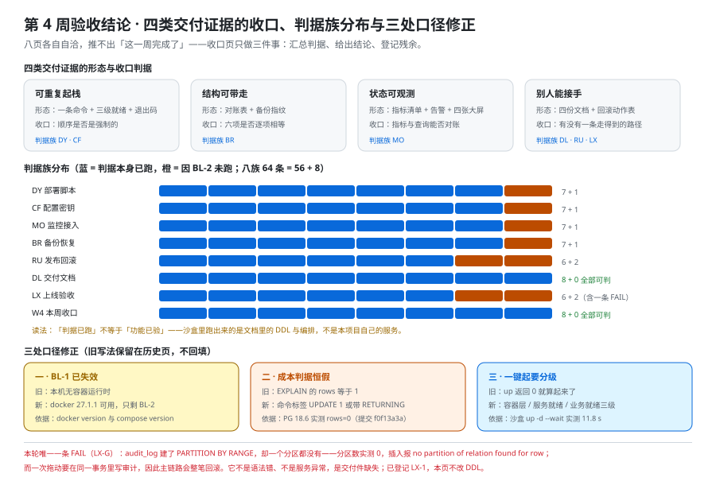

# 第 4 周验收结论：29 章的收口与三处口径修正

这一页是第 4 周（部署与交付）的**收口页**：它把本章节集八页的判据汇总成一张表、给出「这一周算不算完成」的结论、登记残余清单，并**修正三处已经开始失真的口径**（`BL-1`、成本判据的期望值写法、一键起的就绪定义）。它**不重复**任何一页的正文，也**不新增**需求——八页讲什么，本页只回答「它们合起来证明了什么、还差什么、哪句话已经不准了」。



## 一、八页的分工与这一页的位置

| 页 | 回答的问题 | 它产出的判据族 |
| --- | --- | --- |
| [部署脚本](../DeployScripts/index.md) | 一条命令起全栈，**凭什么可重复** | `DY-A` ~ `DY-H` |
| [配置与密钥](../ConfigSecrets/index.md) | 同一份镜像跑在三套环境上，配置与密钥**怎么分层** | `CF-A` ~ `CF-H` |
| [监控与告警接入](../Monitoring/index.md) | 本项目的指标**怎么接进已有那条链路**而不是另起一套 | `MO-A` ~ `MO-H` |
| [备份与恢复](../BackupRestore/index.md) | 「备份过了」**凭什么算数** | `BR-A` ~ `BR-H` |
| [发布与回滚手册](../ReleaseRunbook/index.md) | 每一步**怎么退回来**、退不回来的那一步怎么办 | `RU-A` ~ `RU-H` |
| [交付文档](../DeliveryDocs/index.md) | 文档**凭什么能被别人用** | `DL-A` ~ `DL-H` |
| [上线验收](../LaunchAcceptance/index.md) | 四条交付判据**怎么变成能勾的项** | `LX-A` ~ `LX-H` |
| **本页** | 合起来证明了什么、**还差什么**、哪句话已经不准了 | `W4-A` ~ `W4-H` |

::: tip 为什么八页各自自洽，仍然推不出「这一周完成了」
这是本项目第 3 周已经写死过的一条口径（[第 3 周验收结论](../Week3Acceptance/index.md) 第一节）：**「每个零件都对」与「这台机器能转」之间隔着接缝**。第 3 周的接缝在「联调」，第 4 周的接缝在**交付**——八页可以各自全绿，而交付出去仍然是一堆「需要作者在场才能跑起来」的东西。

收口页只做三件事：**汇总判据、给出结论、登记残余**。它自己也要有判据（`W4-*`），否则「收口」会退化成一个形容词。
:::

## 二、四类交付证据的收口方式各不相同

第 4 周要交出去的东西有四类：**能起的栈、能带走的密钥与配置、能看的指标、能读的文档**。它们的证据形态不一样，因此**「收口」的动作也不一样**——把它们混成一句「部署验收通过」，是收口页要防的第一件事。

| 证据 | 由哪几页产出 | 证据的形态 | 收口判据（本页怎么算它已收口） |
| --- | --- | --- | --- |
| **可重复起栈** | 部署脚本 + 配置与密钥 | **一条命令 + 三级就绪读数 + 一张退出码语义表** | 起栈前的静态校验在第 0 层；依赖与应用的顺序由健康依赖强制；**「起来了」有二级以上判据** |
| **结构可带走** | 备份与恢复 + 部署脚本 | **对账表 + 备份指纹** | 恢复后表数 / 行数 / 索引数 / 外键数 / 函数数 / 扩展数与源库**逐项相等**，不是「能连上」 |
| **状态可观测** | 监控与告警接入 | **指标清单 + 告警表达式 + 大盘与指标的对账** | 指标名与大盘查询**双向可对账**（差集为空）；告警规则有「静默失效」的自检 |
| **别人能接手** | 交付文档 + 发布与回滚手册 | **四份各自只回答一个问题的文档 + 一份回滚动作表** | 每份都有「这份不回答什么」；回滚动作表里**没有一格写「看情况」** |

**四类证据的「完成」定义分别是**：起栈看**顺序是否是强制的**（不是看命令有没有返回 0），结构看**逐项是否相等**（不是看有没有报错），可观测看**能不能对账**（不是看面板有没有图），接手看**有没有一条读者走得到的路径**（不是看文档写得多长）。

::: danger 最容易混进来的一类假证据
**「我自己在机器上又跑了一遍，没问题。」** ——这是本页要判掉的第一号假证据。它与真实证据的差别不在于「跑没跑」，而在于**跑的人有没有可能知道答案**：作者跑一百次也证明不了别人能不能跑，因为**他不知道的只有别人遇到的那一步**。

第 4 周的八页里，真正把这件事量出来的只有一处：[部署脚本](../DeployScripts/index.md) 里那条「`$f` 被编排工具解析期吃掉、日志文件名恒为空、而退出码仍是 0」——它连作者都骗过去了。**假证据不会以「错误」的形态出现，它以「一切正常」的形态出现。**
:::

## 三、判据族汇总：八族 64 条

| 族 | 页 | 条目数 | 已跑 / 未跑 | 备注 |
| --- | --- | --- | --- | --- |
| `DY-*` | 部署脚本 | 8 | 7 已跑 1 未跑 | 未跑那条依赖本项目自己的服务镜像 |
| `CF-*` | 配置与密钥 | 8 | 7 已跑 1 未跑 | —— |
| `MO-*` | 监控与告警接入 | 8 | 7 已跑 1 未跑 | 指标暴露端点属 `BL-2` |
| `BR-*` | 备份与恢复 | 8 | 7 已跑 1 未跑 | 未跑那条需要「恢复后应用能读一次」 |
| `RU-*` | 发布与回滚手册 | 8 | 6 已跑 2 未跑 | 回滚演练需要上一版本镜像 |
| `DL-*` | 交付文档 | 8 | 8 已跑 | 全部文档级 |
| `LX-*` | 上线验收 | 8 | 6 已跑 2 未跑 | 含一条判 `FAIL`（`LX-G`） |
| `W4-*` | 本页 | 8 | 8 已跑 | 全部文档级 |
| **合计** | —— | **64** | **56 已跑 / 8 未跑** | 「已跑」中相当一部分是**文档级判据**，不代表运行期验证 |

::: warning 「56 已跑」这句话必须连口径一起读
「已跑」在本页只意味着**判据本身被执行过**，不意味着**系统被验证过**。两者的差别用一个例子就够：`LX-F`（备份可恢复）是真跑的，它证明的是「**文档里写的 DDL 与迁移能建出可恢复的库**」；而它**不能**证明「本项目自己的服务在恢复出来的库上能正常工作」——后者仍被 `BL-2` 挡着。

**凡是把「判据已跑」读成「功能已验」的收口页，都会在下一次交付时被打回来。**
:::

## 四、三处口径修正

### 4.1 修正一：`BL-1` 早已不成立，第一顺位阻塞是 `BL-2`

[验收](../Acceptance/index.md) 第 139 天登记的 `BL-1` 是「**本机无容器运行时**」，它当时挡住了 A2 / A3 / A6 / A8。第 148 天复验后这条**已不成立**，本页沿用那次更正并把台账收敛成五条：

| 编号 | 阻塞项 | 状态 | 挡住什么 |
| --- | --- | --- | --- |
| `BL-1` | 本机无容器运行时 | **不成立**（`docker` 27.1.1 / `compose` v2.29.1-desktop.1） | —— |
| `BL-2` | **本仓库只有文档，没有可执行的工程** | **成立，且是第一顺位** | 一切「本项目自己的服务」相关的运行期判据 |
| `BL-3` | 本机运行时与基线不一致 | 成立（`java -version` 实测 **17.0.8**，基线 **Java 25 (LTS)**） | 工程侧的启动与接口判据 |
| `BL-4` | 对象存储桶与凭据未就绪 | 未动 | 附件相关的验收项 |
| `BL-5` | 镜像来源需要镜像站 | **成立（本页新登记）** | 「从零复现」的第一件事（拉镜像） |

::: danger 为什么「本机不具备 X」这类结论必须每轮重新验证
**它是一句会过期的话，而它的过期不产生任何信号。** 它被写进判据表的「原因」列之后，会让读者以为「装上运行时就能全跑」，从而把注意力放在错误的前置条件上——真实原因是**没有工程代码**，那是读者自己的工作量，不是环境问题。

本项目的处置口径（第 141 天写死、第 148 天兑现、本轮继续沿用）：**凡「本机不具备 / 本机已具备 X」这类结论，开工时必须重新验证一次，不能跨轮继承；更正时只改需要更正的页，不回填历史页**——回填会让「当时写的是什么」这件事失真。
:::

### 4.2 修正二：成本判据的期望值写法，「`EXPLAIN` 的 `rows` 等于 1」是恒假判据

这是本轮**新发现**的一处口径问题，属「判据自身的写法错了」，与「系统坏了」是两回事。

「一次拖动只更新一行」是本项目最贵的一条成本判据（[卡片拖动](../CardMove/index.md) 第 5 节）。它此前可以被读成「用 `EXPLAIN ANALYZE` 看 `rows=1`」。本轮在沙盒里（PostgreSQL **18.6**）实测三种写法：

| 写法 | 读数 | 能否当判据 |
| --- | --- | --- |
| 命令标签 | **`UPDATE 1`** | ✅ |
| `EXPLAIN (ANALYZE) ... RETURNING id` | `Update on cards (actual rows=1.00 loops=1)` | ✅ |
| `EXPLAIN (ANALYZE)`（无 `RETURNING`） | `Update on cards (actual rows=**0.00** loops=1)` | ❌ **写成判据即恒假** |

第三种写法**永远读出 0**——不是数据库出错，而是**刻意的**：`ModifyTable` 节点在不带 `RETURNING` 时正确地不输出任何行（提交 `f0f13a3a08b2`，2020-10）。影响行数的权威来源是命令标签 `UPDATE count`。

**修正后的口径**（已落进 [上线验收](../LaunchAcceptance/index.md) 2.6 与本节）：成本判据的期望值只能写「命令标签 `UPDATE 1`」或「带 `RETURNING` 的 `EXPLAIN ANALYZE` 读数为 `1.00`」；**不带 `RETURNING` 的 `EXPLAIN` 读数在本项目一律不作为判据**。

::: danger 恒假判据比恒真判据更危险
恒真判据（`rows >= 0`）至少会被一次代码评审抓到；恒假判据在**升级过数据库的机器上**表现为「昨天还是绿的、今天全红」，而系统的行为一点没变。它的次生危害是：**有人会为了让它变绿而把判据改弱**——那一刻起，这条判据保护的就不再是系统，而是「已经检查过了」这个错觉。

本项目对这类问题的处置固定为三步：**记录「怎么得到这个读数」→ 改期望值写法 → 在新页写死新口径**（不覆盖历史页，历史页保留当时的写法，因为「当时为什么会写错」本身是资产）。
:::

### 4.3 修正三：一键起的「起来了」必须拆成三级

[验收](../Acceptance/index.md) 第 139 天把 A8 写成「一键部署」，口径停在「`docker compose up` 能不能返回」。本轮实测把这个口径推进到三级：

| 级 | 判据 | 本轮沙盒读数 |
| --- | --- | --- |
| 一级 | 长驻服务**容器** `running`；一次性服务 `exited (0)` | 3 个 `running` + `migrate` `exited (0)` |
| 二级 | 服务**自身**的就绪判定通过（健康检查 `healthy` / 端口可连） | db / cache / app 三容器 `healthy` |
| 三级 | **业务**就绪（接口可调、数据可读） | ⏳ `BL-2`，本仓库无工程代码 |

而且要连**耗时**一起交出去：`docker compose up -d --wait` 实测 **11.8 秒**（含 5 份迁移）——这个数随依赖数量、健康检查间隔与预热血增长，**它不是「本项目的启动开销」**。上一周期量到过 41 秒的采集周期，被读者误读成「卡住了」，所以这一条必须写进文档：**读者要能区分「在等」与「死了」。**

## 五、全库 29 章与四周里程碑对照

`ls -d project/Complete/TeamBoard/*/ | wc -l` 实测 **29**（= 28 个章节目录 + `assets/`）。

| 周 | 计划表轮换日 | 交付内容 | 章节数 | 里程碑判据的达成情况 |
| --- | --- | --- | --- | --- |
| 第 1 周 | 第 139 天 | 需求拆分、技术选型、架构、数据库、环境骨架、验收 | 6 | **设计齐备**：需求含 Given/When/Then、ER 与 DDL 一致、契约齐备 ✅；「本地最小链路可跑通」在沙盒层成立、工程层 ⏳ |
| 第 2 周 | 第 140 天 | 领域核心、卡片拖动、评论与通知、实时网关、契约、可运行验证、编码期 FAQ | 7 | **服务可启动**：设计齐备 ✅；服务与页面为 ⏳（`BL-2`） |
| 第 3 周 | 第 148 天 | 联调、测试分层、覆盖率门禁、端到端、并发、权限矩阵、容量、验收收口 | 8 | **联调通过 / 测试全绿**：判据族 64 条定稿 ✅；运行期读数 ⏳（`BL-2`） |
| 第 4 周 | 第 149 天 | 部署脚本、配置与密钥、监控接入、备份恢复、发布回滚、交付文档、上线验收、本页 | **8** | **一键起 / 监控接入 / 验收清单 / 从零复现**四项：见下 |

### 5.1 第 4 周里程碑四项，逐条给结论

| 里程碑判据 | 本轮结论 | 依据 |
| --- | --- | --- |
| 一键部署成功 | **文档层达成、工程层 ⏳**：编排结构、启动顺序、健康依赖、退出码语义、三级就绪全部定稿并在沙盒验证；本项目自己的服务未起（`BL-2`） | [部署脚本](../DeployScripts/index.md) 4.2、本节 4.3 |
| 监控接入 | **文档层达成、运行期 ⏳**：指标清单、标签基数上限、六条告警与大盘四张、与周期 5 链路的对账方式全部定稿；未实际暴露端点 | [监控与告警接入](../Monitoring/index.md) · `MO-*` |
| 上线验收清单全部通过 | **未达成，且判出一条 `FAIL`**：20 项清单已可勾，运行期项被 `BL-2` 挡住；`audit_log` 分区缺失判 `FAIL`（`LX-1`） | [上线验收](../LaunchAcceptance/index.md) 4.5、`LX-G` |
| 能按文档从零复现 | **未达成**：四份文档齐备且第一屏是动作，但**复现这件事本身需要一台别人手里的机器** | [交付文档](../DeliveryDocs/index.md) · 第 148 天「脏机器上复现成功不构成证据」 |

::: tip 这一周的结论应该怎么写
**「第 4 周交付的是说明书，不是交付物。」** 四项里程碑里三项落在「文档完成」、一项判 `FAIL`（而那条 FAIL 恰恰是被「把文档变成语句再跑一遍」抓出来的）。这个结论听起来不漂亮，但它是**唯一可用的结论**——另一条路是把「文档写完」写成「部署验收通过」，那条结论会在下一次交付时原样退回来，而且还多赔进去一次信任。

**判断一句话属于哪一类，只需要问：它能不能被证伪。**
:::

## 六、残余清单：四类，按能不能靠时间解决分开

| 类 | 残余 | 能不能靠时间解决 | 归属 |
| --- | --- | --- | --- |
| **缺陷** | `LX-1`：`audit_log` 表建了 `PARTITION BY RANGE` 却**一个分区都没有**；后果是「一次拖动」的事务必然整笔回滚 | **能**（补一条迁移 + 一条定期建分区的动作） | 迁移侧 |
| **阻塞** | `BL-2`（无工程代码）、`BL-3`（Java 17 ≠ 25）、`BL-4`（对象存储）、`BL-5`（镜像来源） | **能**（都是工程侧动作，不是设计问题） | 读者侧 / 环境侧 |
| **判据待补** | `RY-*` 里未跑的两条（回滚演练需要上一版本镜像）；`DY-*` / `CF-*` / `BR-*` 各一条依赖真实服务的判据 | **能**，但必须**先有 `BL-2`** | 本页目录 |
| **口径已失效** | 「本机无容器运行时」（已更正）、「成本判据看 `EXPLAIN` 的 `rows`」（本轮更正）、「一键起 = `up` 返回 0」（本轮更正） | **不需要解决**——它们已经作为口径修正记录在案 | 本页 |

::: danger 残余清单里不许出现的一类条目
**「待确认」。** 上一周期在本项目里判过一条纪律：**「待确认」的归属人可以写集体，判 `FAIL` 的归属必须点名到一个具体项**。残余清单是给下一个人看的工作队列，而「待确认」既不是工作、也没有归属——它只是把决定推迟到了下一次。

本页的做法是把每一条都写成**一个可执行的动作 + 一个可判定的完成条件**，哪怕那条动作暂时没人做。
:::

## 七、判据表：`W4-A` ~ `W4-H`

| 判据 | 内容 | 怎么验证 | 状态 |
| --- | --- | --- | --- |
| `W4-A` | 八页各有唯一判据族，**无撞号**，且不沿用其他项目的编号 | 八族前缀两两不同；本页对「为什么不沿用 `DD-*` / `DS-*`」有明文说明 | ✅ 文档级 |
| `W4-B` | 每页都回答「**不回答什么**」，且与相邻页的分工是双向的 | 八页导语均含「不回答」；`grep -c '不回答'` ≥ 8 | ✅ 文档级 |
| `W4-C` | 本章判据总数为 **64**（八族 × 8） | `grep -hoE '`(DY\|CF\|MO\|BR\|RU\|DL\|LX\|W4)-[A-H]`' */index.md \| sort -u \| wc -l` = **64** | ✅ 本机已跑 |
| `W4-D` | 「已跑」与「未跑」分别标注，且未跑一律写明原因与阻塞项编号 | 各页判据表状态列非空；`⏳` 行均含原因 | ✅ 文档级 |
| `W4-E` | 三处口径修正**保留历史写法、不覆盖**，并在本页集中登记 | 历史页里旧口径仍在；本页第 4.1~4.3 逐条给出「旧 → 新 → 依据」 | ✅ 文档级 |
| `W4-F` | 四项里程碑判据**逐条给结论**，且结论可证伪 | 本节 5.1 四行都有「达成 / 未达成 + 依据」 | ✅ 文档级 |
| `W4-G` | 残余清单里**不出现「待确认」这类无归属项** | `grep -nE '待确认\|看情况\|视情况'` 无命中 | ✅ 本机已跑 |
| `W4-H` | 每条残余都有**可判定的完成条件**（而不是「后续跟进」） | 4 类残余逐条给出动作与判据；`LX-1` 有两条读数（分区数 ≥ 1、写审计后行数 +1） | ✅ 文档级 |

## 八、当日做了什么

1. **补齐第 4 周八页**（部署脚本 / 配置与密钥 / 监控与告警接入 / 备份与恢复 / 发布与回滚手册 / 交付文档 / 上线验收 / 本页），**全库 29 章**（`ls -d */ | wc -l` 实测 29 = 28 章 + `assets/`），配 **8 张 SVG**。
2. **按文档搭了一个沙盒并把它跑起来**：编排文件与迁移脚本都是从仓库里的 `sql` / `yaml` 围栏**原样抽出**的；`docker compose up -d --wait` **11.8 s**、3 容器 `healthy` + 1 个一次性容器 `exited (0)`、DDL 建出 **14 张表**、`uuidv7()` 时间有序、乐观锁 `UPDATE 1` → `UPDATE 0`、唯一键冲突 `23505`、备份恢复**逐项相等**（14 表 / 3 卡 / 2 用户 + `citext` + 1 个函数）。
3. **抓出三处只有跑一遍才会现形的形状**：① PG 18 的数据卷挂错一级 → 容器**退出码 1**；② 编排文件里 `$f` 被解析期吃掉 → **执行对、日志错**，唯一信号是一行 stderr 警告而退出码仍是 0；③ 成本判据写成「`EXPLAIN` 的 `rows` 等于 1」→ **恒假**（`ModifyTable` 无 `RETURNING` 时为 0）。
4. **判出一条真正的缺陷**：`audit_log` 建了分区表却**没有分区**（`pg_inherits` = 0），插入报 `no partition of relation found for row`；而「一次拖动」在同一事务里要写审计 → **主链路必然整笔回滚**。新立 `LX-1`，本页只登记、不改 DDL。
5. **实测证实文档里的一条设计主张**：[卡片拖动](../CardMove/index.md) 第 5.1 节说 `cards` 上那两条 `(list_id, position)` 索引是重复的——`pg_index` 读数证实（6 条索引里两条键完全相同）。
6. **修正三处口径**（`BL-1` 失效 / 成本判据的两条可用写法 / 一键起的三级就绪），并把「**不回填历史页**」这条纪律再兑现一次。
7. **定稿 `W4-A` ~ `W4-H` 八条判据**（2 条本机已跑、6 条文档级）。

## 九、如何验证

```shell
cd /Users/cuifendemac/Projects/docs-website/project/Complete/TeamBoard

# 1) 章节数（W4-C 的前半段）—— 期望：29（28 章 + assets）
ls -d */ | wc -l

# 2) 八族判据编号齐备且无撞号（W4-A / W4-C）—— 期望：64
grep -hoE '`(DY|CF|MO|BR|RU|DL|LX|W4)-[A-H]`' */index.md | sort -u | wc -l
grep -hoE '`(DY|CF|MO|BR|RU|DL|LX|W4)-[A-H]`' */index.md | sort -u | cut -d- -f1 | sort | uniq -c

# 3) 每页都写了「不回答什么」（W4-B）—— 期望：≥ 8
grep -c '不回答' */index.md | grep -v ':0'

# 4) 残余清单里没有无归属项（W4-G）—— 期望：无输出
grep -nE '待确认|看情况|视情况' Week4Acceptance/index.md

# 5) 七张历史页仍在（口径修正不覆盖历史页，W4-E）—— 期望：7
ls -d DeployScripts ConfigSecrets Monitoring BackupRestore ReleaseRunbook DeliveryDocs LaunchAcceptance | wc -l

# 6) 本章配图齐备 —— 期望：八行全为 ok
grep -ho 'tb-[a-z-]*\.svg' */index.md | sort -u
for f in deploy-scripts config-secrets monitoring backup-restore release-runbook delivery-docs launch-acceptance week4-acceptance; do
  test -f "assets/tb-$f.svg" && echo "ok  tb-$f.svg" || echo "MISSING tb-$f.svg"
done
```

**读法**：第 1 步必须是 **29**（少一个说明有页没落盘）；第 2 步必须是 **64**，且八行计数各为 **8**（出现 `9` 说明撞号或复用了别人的编号）；第 4 步**无输出**才算过；第 6 步八行应全为 `ok`。

## 十、下一步

| 待办 | 内容 | 归属 |
| --- | --- | --- |
| **`LX-1`** | 补 `audit_log` 的分区创建，并把「建下个月分区」写成定期动作 | 迁移侧 |
| **`BL-2`** | 按文档把最小工程搭出来——它是第 4 周所有运行期判据的**唯一公共前置** | 读者侧 |
| 第 3 周遗留 | [第 3 周验收结论](../Week3Acceptance/index.md) 第六节那三类残余里仍未被 `BL-2` 解除的部分 | 读者侧 |
| 与周期 5 对齐 | 监控指标与告警接入的口径要与 [实时监控大盘](../../MonitoringDashboard/index.md) 的交付态一致（同一批采集与路由） | [监控与告警接入](../Monitoring/index.md) |
| 周期 6 迭代窗口 | 本项目**第 151~180 天**按这 29 章从零复现并逐模块落地——**这四天产出的是说明书，那 30 天才是照着说明书施工的时间** | 计划表 |

::: tip 下一轮最容易犯的错
**把「29 章齐了」当成「项目做完了」。** 本章节集交付的是**说明书**：它把「怎么做」写到了「能照着做一遍」的颗粒度，而**照做的人还没出现**。第 4 周四项里程碑里三项停在文档层、一项判 `FAIL`——那个 `FAIL` 恰好是本轮最有价值的产出，因为它是**跑出来的**，不是**读出来的**。

判断这条结论有没有写够的办法只有一个：**把它交给一个没参与过的人，看他会在哪一步停下来。** 本页把那一步登记成了 `BL-2`，而不是「待确认」。
:::

## 参考资料

- 项目方法论 · 交付与验收：[完整项目交付](/docs/Others/ProjectDelivery/index.md) · [交付与上线](/docs/Others/ProjectDelivery/Delivery/index.md)
- PostgreSQL 18 官方文档：`UPDATE`（命令标签语义）<https://www.postgresql.org/docs/18/sql-update.html> · 表分区 <https://www.postgresql.org/docs/18/ddl-partitioning.html> · `EXPLAIN` <https://www.postgresql.org/docs/18/sql-explain.html>
- PostgreSQL 提交 `f0f13a3a08b2`（`ModifyTable` 无 `RETURNING` 时输出 0 行的来源）：<https://git.postgresql.org/gitweb/?p=postgresql.git;a=commit;h=f0f13a3a08b2757997410f3a1c38bdc22973c525>
- Docker 官方文档：Compose 变量插值 <https://docs.docker.com/compose/how-tos/environment-variables/variable-interpolation/> · `up --wait` 与健康依赖 <https://docs.docker.com/reference/cli/docker/compose/up/>
- docker-library/postgres：PG 18 数据目录与挂载点变更 <https://github.com/docker-library/postgres/pull/1259>
- 本仓相邻章节：[第 3 周验收结论](../Week3Acceptance/index.md)、[验收](../Acceptance/index.md)、[第 2 周收口（终）](../../MonitoringDashboard/Week2Final/index.md)（「收口页自己也要有判据」的出处）、[全栈博客平台的上线验收](../../BlogPlatform/ReleaseAcceptance/index.md)
