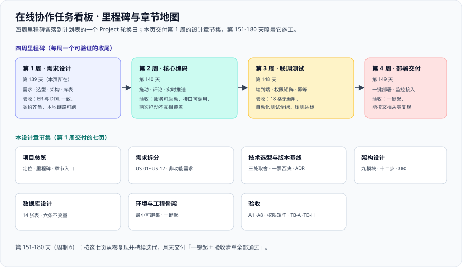

# 在线协作任务看板

周期 6 的从 0 到 1 完整项目：**多个人在同一块看板上，同时改同一批数据，还要每个人都立刻看到别人改了什么。** 它要回答的是一个前五个周期都没有正面回答过的问题——**当「写」不再是单机顺序发生，而是多个人并发落在同一张表上时，业务规则、顺序、通知与权限各自该怎么落地。**

::: warning 本项目只有文档，没有代码
`project/` 是**纯文档目录**：下面所有章节讲的都是「这个项目怎么做出来」——表结构、配置内容、接口契约、目录结构、命令与判据全部写在正文里，但**仓库不存放源码、脚本、SQL 与构建文件**。

正文里出现「运行 `xxx`」时，指的是**先在你的工程里按本节内容创建好该文件**，再执行。
:::

## 一句话定位

一个多租户的协作任务看板：工作区（workspace）里有多块看板（board），看板里有多列（list），列里有多张卡片（card）；成员可以拖动卡片、评论与 `@` 提及、上传附件，**所有改动实时出现在其他人的屏幕上，并且每一次改动都留得下痕迹**。

月末交付判据：**一键起、两个人同时拖动不打架、越权请求全部被拒、断线重连不丢改动、按文档能从零复现。**

## 为什么是「协作看板」

前五个周期的项目，覆盖面一步步从「单机」走向「多组件」：

| 备选项目 | 为什么不选 / 为什么选它 |
| --- | --- |
| 又一个内容型系统（社区、问答） | 周期 4 的[全栈博客平台](../BlogPlatform/index.md)已经做过「写-读为主」的系统，重复的不是技术栈而是**问题类型** |
| 又一个观测型系统 | 周期 5 的[实时监控大盘](../MonitoringDashboard/index.md)刚做完采集 → 存储 → 规则 → 通知的全链路 |
| IM / 聊天室 | 消息一旦发出就不再改动，**回避了本项目最核心的难点：同一份可变状态的并发写入** |
| **协作任务看板** | 它把三个真实难点同时摆上台面：① **并发写**（两个人拖同一张卡片）；② **实时性**（改动要立刻出现在别人屏幕上）；③ **权限**（同一个看板对不同角色是不同东西）。三者互相牵制——例如为了实时性牺牲一致性、为了权限牺牲缓存，都是必须当场做出的取舍 |

::: tip 与前一个项目的相邻关系
周期 5 的项目**观测**别人的系统，本项目的难点在**自己系统的写入路径**上。
两者共用的资产恰恰是被观测的那一套：本项目的接口指标、错误率与延迟都要按周期 5 定稿的口径暴露，**第 4 周的上线验收会直接复用那套采集与告警链路**。
:::

## 与既有资产的关系

| 既有资产 | 在本项目中的用法 |
| --- | --- |
| [后端通用模板](../../Base/BackendTemplate/index.md) | **后端基座**：认证、统一响应、异常处理、多环境配置、CI 门禁直接复用，本项目只写协作领域逻辑 |
| [Vue3 前端模板](../../Base/Vue3Template/index.md) | **前端基座**：目录结构、请求封装、状态管理、构建与发布流程复用 |
| [全栈博客平台](../BlogPlatform/index.md) | **最近的同类经验**：它做过「权限 + 令牌 + 迁移脚本」的完整落地，本项目的账号与权限表设计直接继承它的三段式迁移纪律 |
| [完整项目交付](/docs/Others/ProjectDelivery/index.md) | **方法论**：需求、架构、数据模型、契约、测试、交付六份文档的写法归它，本项目是它在「协作型系统」上的实例 |
| [性能与容量工程](/docs/Ops/PerformanceEngineering/index.md) | **容量口径**：水位线、峰均比、开环压测与 SLO 的定义归它，本项目只填自己的数 |
| [实时通信契约](/docs/Backend/ReactiveProgramming/index.md) | **流与背压的观念**：SSE / WebSocket 的取舍与「出口没有真背压」这条现实，本项目在推送链路上直接面对 |
| [分布式缓存](/docs/Backend/DistributedCache/index.md) | **多实例广播**：Redis 的发布订阅与「缓存与数据库谁先写」的取舍 |
| [项目实战 · 实时监控大盘](../MonitoringDashboard/index.md) | **部署与被观测形态**：Compose 编排、指标暴露、告警接线的既有做法 |

## 技术选型（结论）

完整论证（含被否掉的方案与代价）在 [技术选型与版本基线](./TechStack/index.md)，这里只放结论：

| 层 | 选型 | 一句话理由 |
| --- | --- | --- |
| 前端 | **Vue 3.5 + Vite + TypeScript + Pinia** | 复用前端模板；拖拽用成熟库，不自研手势 |
| 后端 | **Java 25（LTS）+ Spring Boot 4.1** | 复用后端模板；实时链路用 Spring 自己的 WebSocket 支持，不引入第二个运行时 |
| 数据库 | **PostgreSQL 18** | 一个库同时解决关系、并发控制与全文搜索，30 天周期内不引入第二套存储 |
| 实时通道 | **WebSocket（STOMP 语义）+ Redis 发布订阅** | 多实例部署时「广播」必须跨进程，这是唯一需要外部依赖的地方 |
| 顺序与并发 | **乐观锁（`version`）+ 分数排序键（fractional ranking）** | 拖动是「重排」，用整数 `position` 重排必然引发全列更新 |
| 通知 | **事务内写 outbox 表 + 异步投递** | 「评论成功但通知丢了」是协作系统最容易被投诉的一类不一致 |
| 附件 | **S3 兼容对象存储 + 预签名上传** | 附件不穿业务库；签名把「能不能下载」交给服务端判定 |
| 部署 | **Docker Compose 一键起** | 与周期 5 同构，减少「换项目就要重学部署」的成本 |

## 四周里程碑

四个 Project 轮换日各交付一批文档，每周都有可验证的验收判据——**四周走的是「需求设计 → 核心编码 → 联调测试 → 部署验收」这条固定顺序**：

| 周 | 计划表轮换日 | 内容 | 验收判据 |
| --- | --- | --- | --- |
| 第 1 周 | 第 139 天 | 需求拆分、技术选型、架构设计、数据库设计、环境骨架 | 需求含 Given/When/Then；ER 图与 DDL 一致；接口契约齐备；本地最小链路可跑通 |
| 第 2 周 | 第 140 天 | 核心链路编码：卡片拖动、评论与提及、实时推送 | 服务可启动、接口可调用、页面可访问、两次拖动不互相覆盖 |
| 第 3 周 | 第 148 天 | 联调与测试：端到端、权限矩阵、幂等与并发、容量 | 联调通过、自动化测试全绿、权限矩阵 18 格无漏判、压测达标 |
| 第 4 周 | 第 149 天 | 部署与交付：一键部署、监控接入、交付文档 | 一键起、指标与告警接入、上线验收清单全部通过、能按文档从零复现 |

::: info 与周期 6（第 151-180 天）的关系
本项目的**设计与编码文档**落在计划表的四个 Project 轮换日上（第 139、140、148、149 天），而**第 151-180 天**是按这些文档从零复现、并把每个模块写到「能照着做一遍」的持续迭代窗口。
换句话说：**这四天产出的是说明书，周期 6 才是照着说明书施工的时间。**
:::

::: tip 第 149 天交付 8 章（合计 29 章）
设计期 6 章（第 139 天）+ 编码期 7 章（第 140 天）+ 联调期 8 章（第 148 天）+ 交付期 8 章（第 149 天），**本设计 / 编码 / 联调 / 交付章节集合计 29 章**，四周走完「需求设计 → 核心编码 → 联调测试 → 部署验收」。

数字不靠估：`ls -d project/Complete/TeamBoard/*/ | wc -l` 在本机实测为 **33**（= 32 个章节目录 + `assets/`），其中第 139、140、148、149 天各批合计 29 章。

第 151 天起进入周期 6 的施工窗口，按同样的四周顺序继续增量：第 151 天交付 [多租户隔离](./MultiTenancy/index.md) 1 章、第 152 天交付 [租户上下文与索引设计](./TenantIndexing/index.md) 1 章、第 153 天交付 [事件表与顺序字段](./EventSequence/index.md) 1 章、第 154 天交付 [拖动写入路径](./DragWritePath/index.md) 1 章，**当前全书 33 章**。
:::

## 进度跟踪

| 日期 | 产出 | 状态 |
| --- | --- | --- |
| 第 139 天 | 需求与架构：本设计章节集（7 章）——三类角色与 US-01~US-12、技术选型与版本基线、架构细化与实时同步设计、数据库设计与完整 DDL、环境骨架与本地可跑验证、验收口径与权限矩阵 | ✅ 完成 |
| 第 140 天 | 核心链路编码：领域核心与读写服务、卡片拖动的顺序与并发、评论与通知的 outbox、实时网关的订阅鉴权与追平、接口契约定稿、可运行验证、编码期 FAQ | ✅ 完成 |
| 第 148 天 | 联调与测试：前后端联调、自动化测试策略与覆盖率门禁、端到端与并发用例、权限矩阵联调、容量验证、第 3 周验收收口（**8 章**） | ✅ 完成 |
| 第 149 天 | 部署与交付：一键部署脚本、配置与密钥分层、监控与告警接入、备份与恢复、发布与回滚手册、四份交付文档、上线验收清单、第 4 周收口（**8 章**） | ✅ 完成 |
| 第 151 天 | 周期 6 施工第 1 周第 1 步：多租户隔离（租户三级模型、三种隔离方案取舍、`tenant_id` + `FORCE RLS` + 复合唯一键的 DDL、上下文四层传播、两个必失点与验收）（**1 章**） | ✅ 完成 |
| 第 152 天 | 周期 6 施工第 1 周第 2 步：租户上下文与索引设计（五条高频查询的索引清单、`EXPLAIN` 前后对照与读数纪律、`SET LOCAL` 必须在事务内的三种写法、20 连接 200 并发不串租户的三条读数、四个索引反例）（**1 章**） | ✅ 完成 |
| 第 153 天 | 周期 6 施工第 1 周第 3 步：事件表与顺序字段（`seq` 三种分配方式的取舍与两个实测反例——`max+1` 并发撞号、序列回滚留空洞；全局单调 vs 每板连续的判定；`board_events` 完整 DDL；游标 0.031 ms / 7 页 对 offset 29.83 ms / 1,224 页；三层去重）（**1 章**） | ✅ 完成 |
| 第 154 天 | 周期 6 施工第 1 周第 4 步：拖动写入路径（一次拖动在一个事务里改 `cards`、写 `board_events`、写 `outbox`；乐观锁 `where version = ?` 与 409 口径；`seq` 紧贴插入获取、回滚留空洞；`position_key` 允许相等靠 `id` 二级排序；四个故障注入实验的预期读数；与第 140 天 `CardMove` 六条成本判据的逐条对齐）（**1 章**） | ✅ 完成 |

## 各章节

1. [需求拆分：角色、故事与验收条件](./Requirements/index.md)：三类角色的关注点、US-01~US-12 与 Given/When/Then、非功能需求与容量目标、范围外四项、需求到判据的映射
2. [技术选型与版本基线](./TechStack/index.md)：选型三原则、逐层选型表、三处关键取舍的完整论证、四条一票否决、版本事实与决策记录
3. [架构设计：模块边界与实时链路](./Architecture/index.md)：九个模块的职责与「不做什么」、一次拖动的完整链路、实时同步的 `seq` 机制与断线补拉、三处权限判定点、八个失败模式
4. [数据库设计：表、约束与顺序字段](./Database/index.md)：14 张表的清单与完整 DDL、乐观锁与分数排序键、`board_events` 与单调序号、索引与全文搜索、六条不变量、迁移三分法
5. [环境与工程骨架](./Environment/index.md)：本地最小可跑集、完整目录结构、`compose.yaml` 与 `.env`、一键起与四条验证、五类启动失败排查
6. [验收：把「做完了」变成可执行的步骤](./Acceptance/index.md)：A1~A8 验收步骤、权限矩阵 18 格、判据 `TB-A~TB-H`、阻塞项台账与最短路径
7. [领域核心与读写服务](./DomainCore/index.md)：聚合与不变量的落点、模块边界内的读写服务、事务边界与领域事件的产生点、以及「规则写在哪一层」的口径
8. [卡片拖动：顺序与并发](./CardMove/index.md)：一次拖动的服务端十二步、分数排序键的生成与退化压缩、乐观锁与 `409` 响应契约、幂等键落地、成本判据「一次拖动只更新一行」
9. [评论与通知：事务内 outbox](./Comments/index.md)：评论与 `@` 提及的解析口径、outbox 写入与投递循环、`dedup_key` 去重、未读的游标口径、投递积压与重投的处理
10. [实时网关：订阅鉴权与追平](./RealtimeGateway/index.md)：握手与按看板订阅的鉴权、`seq` 分配与「提交后才广播」的时序、心跳与指数退避重连、每连接队列上限与 `resync_required`、客户端缺口补拉
11. [接口契约定稿](./Contracts/index.md)：拖动、评论、附件签名三条契约的请求与响应、`401`/`403`/`404`/`409` 的状态码口径、事件形状与主题命名、契约的校验方式
12. [可运行验证：在本地复现编码链路](./Verification/index.md)：按环境骨架把依赖与服务起起来、拖动与并发两条链路的实跑步骤、断线补拉的观察方法、验证结果与阻塞项的如实登记
13. [常见问题与最佳实践：编码期分诊与自查](./FAQ/index.md)：十二条现象分诊、高频十二问、编码期自查清单 18 项、十二条最佳实践、术语表 16 项与六条本机可判的 `grep -c` 判据（`FQ-A~FQ-F`）
14. [前后端联调：契约、错误码与时序的对齐](./Integration/index.md)：联调的四个对象、字段级对齐清单、五个错误码的实跑口径、序列化四条类型纪律、一次拖动的两条时序路径，判据 `IG-A~IG-H`
15. [自动化测试分层：四层金字塔与测试数据的隔离](./TestStrategy/index.md)：四层的职责边界与量化配比、测试替身的红线、容器化集成的落地口径、测试数据三类与隔离三手段，判据 `TS-A~TS-H`
16. [覆盖率门禁：只卡「新写的那几行有没有被验到」](./CoverageGate/index.md)：行 / 分支 / 变更三条口径各自的假绿、门禁五步链、三档阈值的定值理由、棘轮与豁免四要素，判据 `CV-A~CV-H`
17. [端到端测试：只测必须跨进程才能证伪的东西](./E2ETest/index.md)：三条准入与四类伪需求、七条用例 `E2E-1~E2E-7`、三种数据来源与三条清理纪律、失败分诊五类现象到四类归属，判据 `ET-A~ET-H`
18. [并发与幂等专项：让「偶发」变成可复现的读数](./Concurrency/index.md)：四类并发场景的可证伪结论、确定性并发的四种手段、栅栏写法、三条成本读数（一次拖动只更新一行），判据 `CC-A~CC-H`
19. [权限矩阵验证：把 18 格变成 18 个会失败的用例](./PermissionMatrix/index.md)：18 格的验证结构、两条贯穿全表的边界、三层判定、元判据与 CI 步骤，判据 `PM-A~PM-H`
20. [压测与容量验收：把「能扛多少」变成有前提的结论](./CapacityTest/index.md)：四个场景模型（写 40 / 读 120 / 拖动 30 RPS / 长连接 1 万）、瓶颈定位四层、广播放大系数、容量结论的四个前提，判据 `CAP-A~CAP-H`
21. [第 3 周验收结论：四类证据的收口与一处口径更正](./Week3Acceptance/index.md)：七页分工表、四类证据的收口方式、判据族汇总（八族 64 条 = 文档级 56 + 运行期 8）、三类残余、一处口径更正（`BL-1`），判据 `W3-A~W3-H`
22. [部署脚本：一条命令起全栈，以及它凭什么可重复](./DeployScripts/index.md)：一条命令的八步链路、完整编排文件与一键起脚本、三级就绪与退出码语义、迁移的幂等与版本记录，判据 `DY-A~DY-H`
23. [配置与密钥：同一份镜像跑在三套环境上](./ConfigSecrets/index.md)：配置三分法与完整环境变量清单、多环境分层写法、密钥四级落点、启动期配置校验、三套环境漂移对账，判据 `CF-A~CF-H`
24. [监控与告警接入：把本项目的指标接进周期 5 那条链路](./Monitoring/index.md)：继承四项与自补三项、四组指标与标签基数上限（高基数黑名单）、`/actuator/prometheus` 三条纪律、六条告警与静默失效自检、四张大盘与观测点取舍，判据 `MO-A~MO-H`
25. [备份与恢复：验证过的备份才算备份](./BackupRestore/index.md)：备份的三个层次与方式对照、`pg_dump` / `pg_restore` 实测与六项对账、单表恢复的代价（裸表）、备份四条纪律与恢复演练步骤，判据 `BR-A~BR-H`
26. [发布与回滚手册：每一步都要能退回来](./ReleaseRunbook/index.md)：三条发布前置门禁、迁移三分法（加列可退 / 改名不可退 / 删列只能向前）、发布步骤表与回滚决策树、按工作区白名单灰度、冻结期、回滚演练，判据 `RU-A~RU-H`
27. [交付文档：四份文档各自只回答一个问题](./DeliveryDocs/index.md)：四类读者的时机分野、篇幅上限与第一屏纪律、四份骨架（快速开始 / 部署手册 / 上线验收清单 / 故障应对索引）、引用不成环、交付物台账与 `project/` 硬边界，判据 `DL-A~DL-H`
28. [上线验收：把四条交付判据变成能勾的项](./LaunchAcceptance/index.md)：编码期验收与上线验收的分野、四条判据拆成 20 项可勾选项、期望值列的形容词清洗、成本判据期望值的三条写法（一条恒假）、沙盒实测与唯一一条 `FAIL`、阻塞项台账 `BL-1`~`BL-5`，判据 `LX-A~LX-H`
29. [第 4 周验收结论：29 章的收口与三处口径修正](./Week4Acceptance/index.md)：八页分工表、四类交付证据的收口方式、判据族汇总（八族 64 条 = 56 + 8）、三处口径修正、四周里程碑逐条结论、四类残余清单（`LX-1` 与 `BL-2`~`BL-5`），判据 `W4-A~W4-H`
30. [多租户隔离：把「同表不同租户」变成数据库级别的边界](./MultiTenancy/index.md)：租户三级模型与「不合并 tenant 与 workspace」的理由、三种隔离方案对照与选行级的三条依据、`FORCE RLS` 与复合唯一键的完整 DDL、上下文四层传播（含 `SET LOCAL` 与连接池串租户）、读越权与键冲突两个必失点，判据 `TN-A~TN-H`
31. [租户上下文与索引设计：把「按租户过滤」变成索引前缀](./TenantIndexing/index.md)：五条高频查询的索引清单与四条列序纪律、`EXPLAIN (ANALYZE, BUFFERS)` 前后对照与「只看访问方式、rows、Buffers」的读数纪律、`set_config(..., true)` 必须在显式事务内的三种写法对照、20 连接 200 并发不串租户的三条读数、四个索引反例，判据 `TI-A~TI-H`
32. [事件表与顺序字段：把「断线追平」落到数据库](./EventSequence/index.md)：`seq` 三种分配方式的取舍（`max+1` 并发撞号的实测、序列回滚留空洞的实测、行锁计数器的代价）、全局单调 vs 每板连续的判定、`board_events` 完整 DDL 与四条约束、游标分页 0.031 ms 对 offset 29.83 ms（962 倍）、三层去重（origin / seq / event_id），判据 `ES-A~ES-H`
33. [拖动写入路径：三张表要么都成、要么都不成](./DragWritePath/index.md)：一次拖动的五次变化与三张表、三种拆分方式的后果、完整 DDL 与四条约束、写入顺序的三条依赖、服务端九步与五处细节（乐观锁 / 幂等同事务 / `nextSeq` 紧贴 / `afterCommit` 只做一件事）、两个并发场景的预期读数、四个故障注入实验、与第 140 天 `CardMove` 判据的逐条对齐，判据 `DWP-A~DWP-H`

## 与 docs 的关系

- `docs/` 讲原理与用法：[项目交付方法论](/docs/Others/ProjectDelivery/index.md)、[性能与容量工程](/docs/Ops/PerformanceEngineering/index.md)、[分布式缓存](/docs/Backend/DistributedCache/index.md)、[数据建模](/docs/DB/DataModeling/index.md)。
- `project/` 把它们串成可照做的工程步骤，并提供完整的表结构、契约内容与命令。

## 参考资料

- 项目方法论：[完整项目交付](/docs/Others/ProjectDelivery/index.md) · [需求与验收条件](/docs/Others/ProjectDelivery/Requirements/index.md) · [架构文档](/docs/Others/ProjectDelivery/Architecture/index.md)
- 数据与顺序字段：[数据建模](/docs/DB/DataModeling/index.md) · [PostgreSQL 专题](/docs/DB/Relational/PostgreSQL/index.md)
- 容量与压测：[性能与容量工程](/docs/Ops/PerformanceEngineering/index.md) · [压测方法论](/docs/Ops/PerformanceEngineering/LoadTesting/index.md) · [容量规划与弹性](/docs/Ops/PerformanceEngineering/Capacity/index.md)
- 上一周期同类资产的收口方式：[实时监控大盘](../MonitoringDashboard/index.md) · [全栈博客平台的上线验收](../BlogPlatform/ReleaseAcceptance/index.md)
